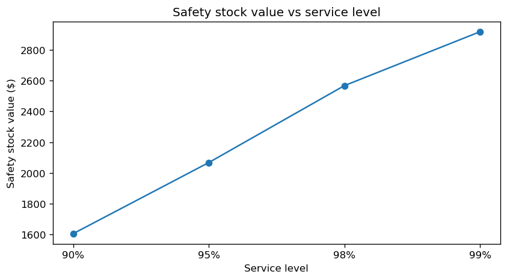

# Walmart M5 Demand Forecasting and Inventory Planning (Python)

Forecasting weekly demand for the 20 best-selling food products in a Walmart store in Texas, comparing three forecasting methods, and turning the forecasts into safety stock and reorder points.

**Highlights**
- Forecast weekly demand for 20 Walmart SKUs, reaching about **10% WAPE on the top 4 sellers**
- Flagged 4 products whose demand collapsed in the test period (likely stockouts or delistings) using error and bias analysis
- Found that raising the service level from 95% to 99% needs **41% more safety stock**
- Measured demand drivers: SNAP days lift daily sales by about **9%**, and Easter by about **75%**

## Business question
How much of each product will sell in the coming weeks, and how much stock should the store hold? Over-forecasting ties up cash in excess inventory. Under-forecasting causes empty shelves and lost sales.

## Data
[M5 Forecasting Accuracy](https://www.kaggle.com/competitions/m5-forecasting-accuracy) on Kaggle: about 5 years of real daily Walmart sales (2011 to 2016) for 3,049 products across 10 stores, plus a calendar (holidays, SNAP days) and weekly prices.

This project uses store **TX_1**, category **FOODS**, and the **top 20 products** by total units sold.

> The data files are not included in this repo. Download `sales_train_evaluation.csv`, `calendar.csv` and `sell_prices.csv` from Kaggle and put them in the same folder as the notebook.

## Approach
**1. Prepare the data:** reshape daily sales from wide to long, join the calendar, and sum daily units into Walmart weeks (Saturday to Friday). Incomplete weeks are removed so a partial week doesn't look like a sales drop.

**2. Explore:** 4-week moving averages, seasonal decomposition (trend, yearly seasonality, noise), and the sales lift on SNAP days and holidays.

**3. Forecast:** hold out the last 12 weeks, then compare three methods:
- **Moving average:** average of the last 4 weeks (baseline)
- **Seasonal naive:** same week last year
- **Holt-Winters exponential smoothing:** damped trend plus a 52-week seasonal pattern

Each forecast is scored against actual sales with MAE, WAPE, MAPE and bias, and the most accurate method is kept for each product.

**4. Inventory plan:** use each product's forecast error to set safety stock and reorder points, and measure how much extra inventory higher service levels require.
- Safety stock = Z × forecast error standard deviation × √(lead time)
- Reorder point = (average weekly forecast × lead time) + safety stock

## Results
**Forecast accuracy (20 SKUs, 12-week holdout)**
| Metric | Moving average | Seasonal naive | Holt-Winters |
|---|---|---|---|
| Average WAPE | 42.4% | 70.8% | 68.2% |
| Median WAPE | 26.3% | 42.0% | 32.0% |
| Products won | 12 of 20 | 1 of 20 | 7 of 20 |

Choosing the best method for each product gives an average WAPE of **39.6%**. Averages are pulled up by 4 outlier products (see below); medians are a fairer summary.

**Key findings**
- The 4 highest-volume products (over 200 units a week) forecast at about **10% WAPE**. Accuracy falls as weekly volume drops.
- The simple moving average was hard to beat in stable periods, winning on 12 of 20 products. Holt-Winters won on 7, mostly mid-volume products with stronger seasonality.
- 4 products (FOODS_3_541, FOODS_3_808, FOODS_3_234, FOODS_3_635) had over 100% error because demand dropped to near zero in the test period (recent 4-week averages of 0 to 26 units vs a long-run average of 72 to 84), likely stockouts or delistings. They need investigation, not just a better model.
- Holt-Winters tended to over-forecast (positive bias on 14 of 20 products), which would build excess inventory.
- Top seller FOODS_3_586 dropped about 25% in volume between 2012 and 2013, then stabilized, with a strong summer peak each year.
- SNAP days lifted daily sales by about **8.9%**. Holidays mattered more: Easter (+75%), Father's Day (+56%) and Thanksgiving (+54%) raised sales, while sales stopped on Christmas Day (store closed) and dipped on New Year's Day (-30%).

**Inventory plan (2-week lead time)**
| Service level | Safety stock (units) | Safety stock value |
|---|---|---|
| 90% | 1,025 | $1,604 |
| 95% | 1,321 | $2,067 |
| 98% | 1,642 | $2,568 |
| 99% | 1,866 | $2,919 |

Moving from 95% to 99% service needs about **41% more safety stock**. Each step up in service costs more than the last, which is why the target service level is a business decision, not just a modeling choice.



## Accuracy metrics
| Metric | Meaning |
|---|---|
| MAE | Average units missed per week |
| WAPE | Total miss ÷ total sales (main score; works with zero-sales weeks) |
| MAPE | Average % miss per week (skips zero-sales weeks) |
| Bias | Positive = forecast too high (excess stock); negative = too low (stockouts) |

## Limitations and next steps
- Forecast error comes from a 12-week holdout, so safety stock is a rough estimate. A rolling backtest over more weeks would make it steadier.
- The 2-week lead time is an assumption.
- Next: simulate a year of ordering with these reorder points, and build a Power BI dashboard from the results.

## How to run
```
pip install -r requirements.txt
jupyter notebook M5_Demand_Forecasting_and_Inventory.ipynb
```

## Tools
Python, pandas, statsmodels, matplotlib, Jupyter
